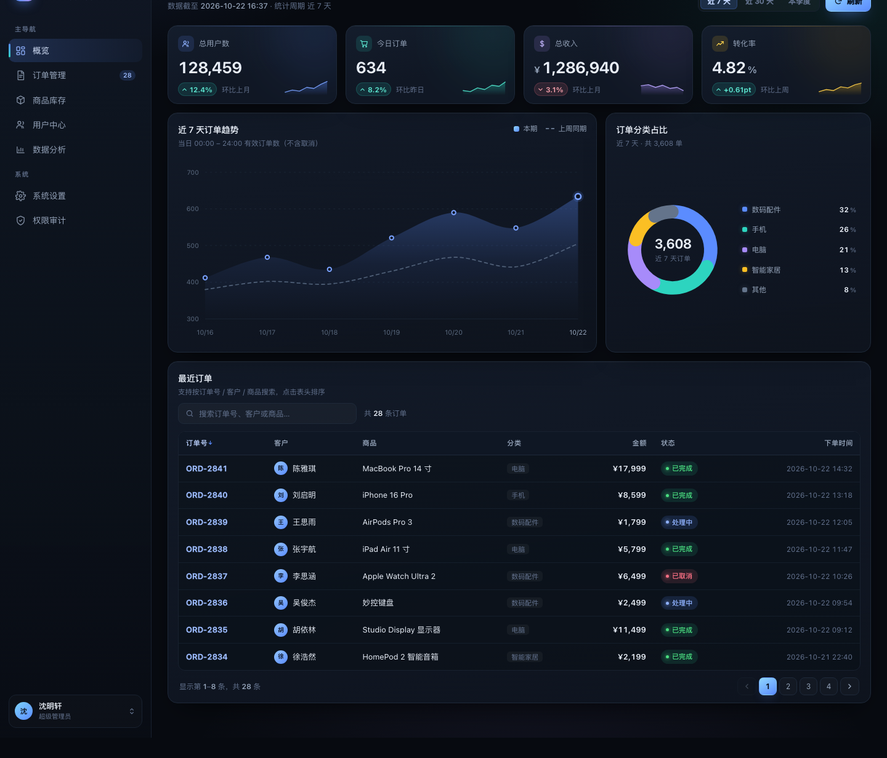

# 运营后台仪表盘 · Admin Dashboard

单文件 HTML 实现的深色主题后台管理仪表盘，**零外部依赖**（无 CDN、无图表库、无外部字体），直接用浏览器打开即可运行。



## 功能

**KPI 卡片**
总用户数 / 今日订单 / 总收入 / 转化率四张卡片，包含趋势箭头、环比文案、卡内迷你 sparkline，数字带缓动递增动画。

**近 7 天订单趋势（SVG 折线图）**
本期实线（蓝→青渐变描边 + 面积渐变）对比上周同期虚线；悬停显示日期、本期、上周、同比浮层，并跟随一条竖向导引线。入场有描边绘制动画。

**订单分类占比（SVG 环形图）**
5 个分类由三角函数计算 path 弧段拼成；悬停时该段加粗高亮、其余变暗，圆心文字切换为「百分比 + 分类名」，图例同步高亮。

**最近订单表格**
- 搜索：订单号 / 客户 / 商品 / 分类
- 排序：点击表头切换升降序，箭头指示方向
- 分页：每页 8 条，窗口化页码
- 空状态：无匹配结果时给出提示

## 使用

```bash
# 方式一：直接打开
open dashboard.html

# 方式二：起个本地服务
python3 -m http.server 8000
# 访问 http://localhost:8000/dashboard.html
```

## 技术要点

| 关注点 | 做法 |
| --- | --- |
| 折线图自适应 | 按容器 `clientWidth` 动态设置 `viewBox` 宽度（夹在 320–940），`resize` 时防抖重绘，保证窄屏下坐标轴文字不缩水 |
| 环形图渲染 | 用 `sin/cos` 计算起止点生成 `<path>` 圆弧，避开 SVG `transform` 属性与 CSS `transform-origin` 相互干扰导致元素位移的问题 |
| 图表交互 | 无第三方库，悬停命中通过透明 `<rect>` 捕获，按 x 坐标就近取点，浮层用像素级定位贴合数据点 |
| 表格 | 原生 DOM 渲染，搜索 + 排序 + 分页状态集中在单一 `state` 对象，每次操作整体重渲染 |
| 响应式 | 1440 / 820 / 390 三档断点实测；≤1040px 侧边栏转为抽屉，≤620px KPI 单列、图表堆叠 |

## 目录结构

```
.
├── dashboard.html      # 全部内容（HTML + CSS + JS 内联）
├── docs/
│   └── preview.png     # README 预览图
└── README.md
```

## 说明

页面中的订单、用户数等均为演示用模拟数据。
